# TriBin

Corbeille intelligente pour agences : on glisse un fichier, l'IA propose **où le ranger** et **comment le renommer**
selon la convention de l'équipe ; l'utilisateur valide ou corrige, et l'IA apprend de ses corrections.
Spécification complète et état d'avancement : [SPEC.md](SPEC.md).

## Aperçu

<p align="center"></p>

**Fenêtre principale**, en trois colonnes : la navigation ; les fichiers à ranger, groupés en « À vérifier » et
« Prêts à ranger », avec recherche et onglets ; puis la proposition de l'IA pour le fichier sélectionné : nouveau
nom, dossier, catégorie, confiance (turquoise = sûr, ambre = à regarder, corail = à vérifier), explication et autres
possibilités. Les actions sont en bas : « Ranger ici » (Entrée), « Passer » (Échap), « Renvoyer à l'origine » (R).

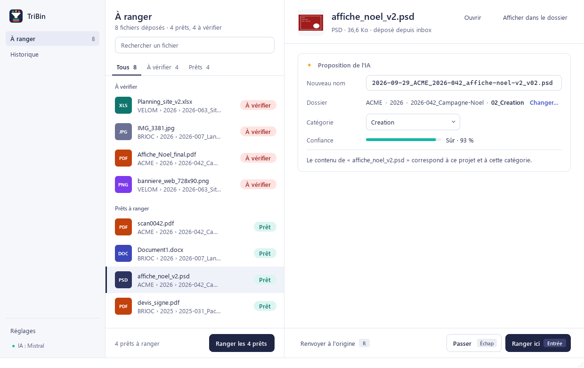

| Fichier à vérifier | Simulation avant un rangement par lot |
|---|---|
| 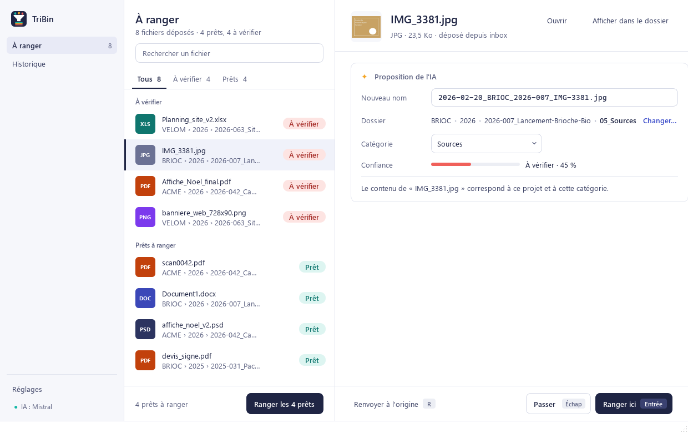 | 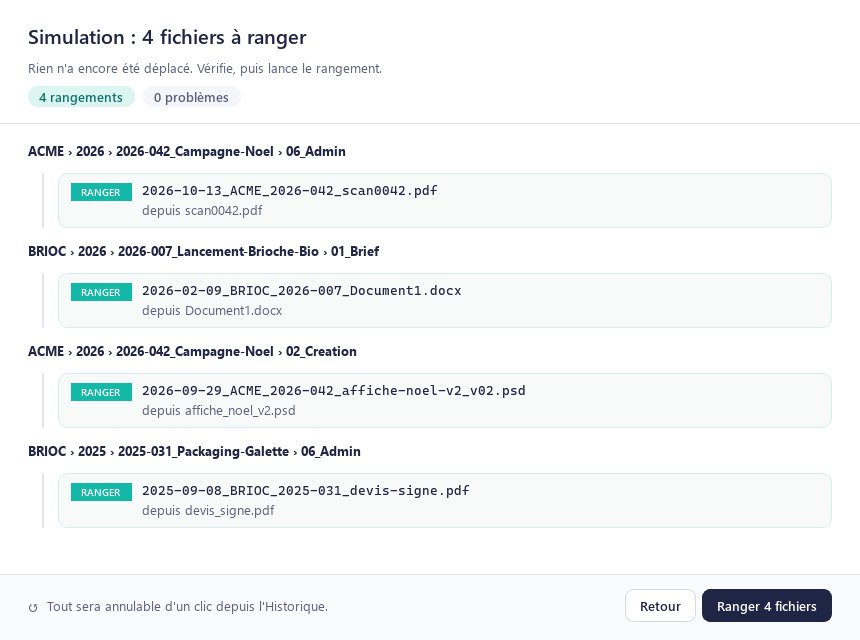 |

| Historique (par lot, tout est annulable) | Tout est rangé |
|---|---|
| 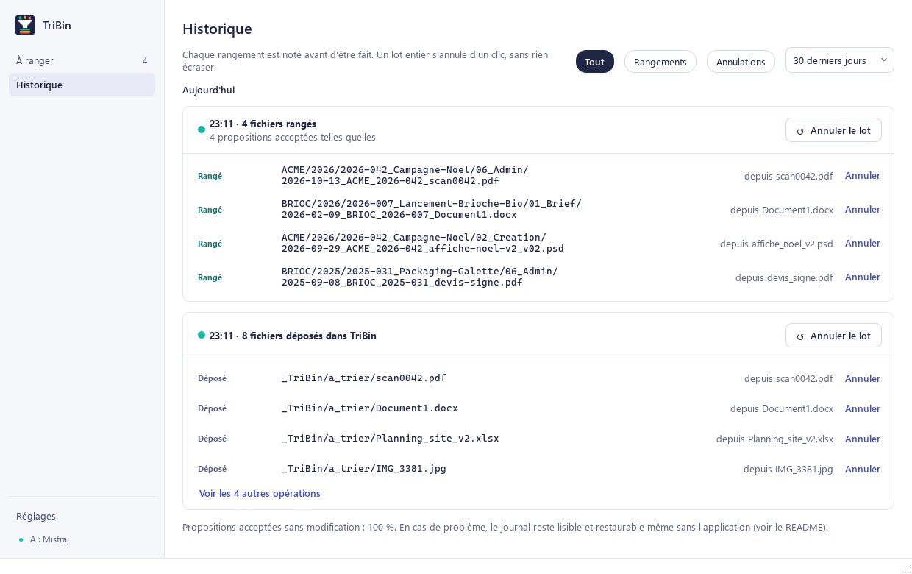 | 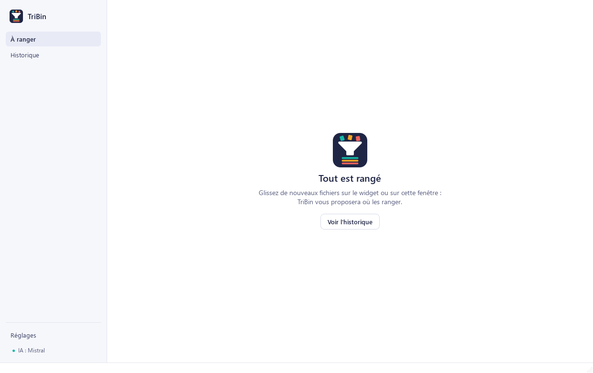 |

| Widget de dépôt : au repos | analyse en cours | prêt à valider |
|---|---|---|
|  |  |  |

**Premier lancement**, en quatre étapes listées à gauche : bienvenue, dossiers à ranger et à ne jamais toucher
(choisis un par un ; la convention est déduite automatiquement), quelques questions facultatives, choix de l'IA
(Mistral, Claude ou Gemini).

| 1. Bienvenue | 2. Vos dossiers |
|---|---|
| 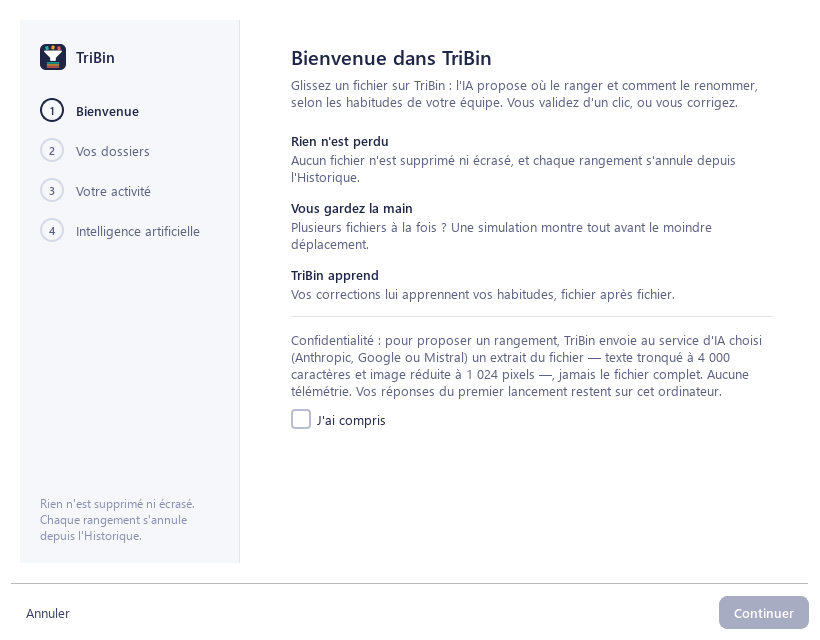 | 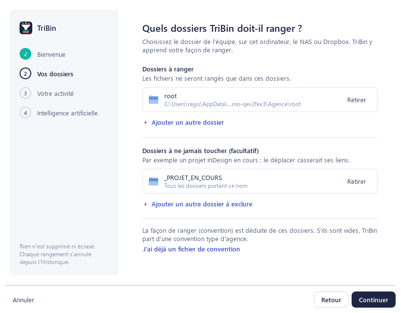 |

| 3. Votre activité | 4. Intelligence artificielle |
|---|---|
| 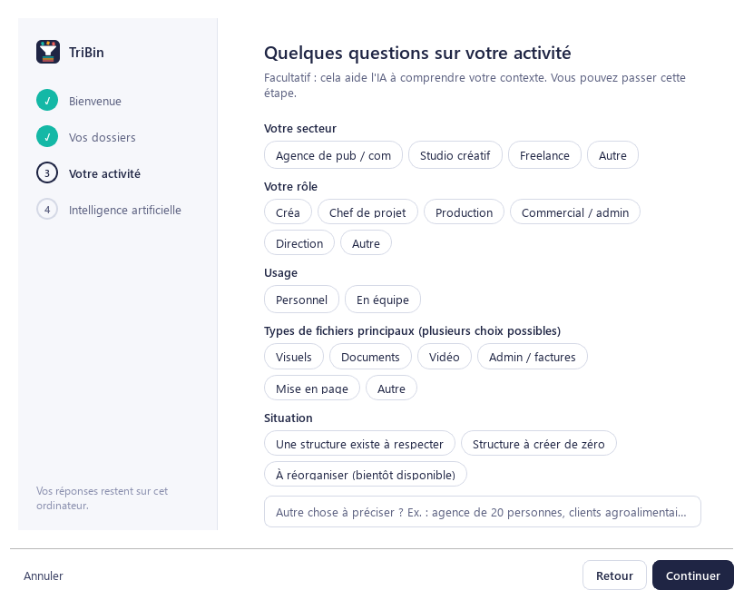 | 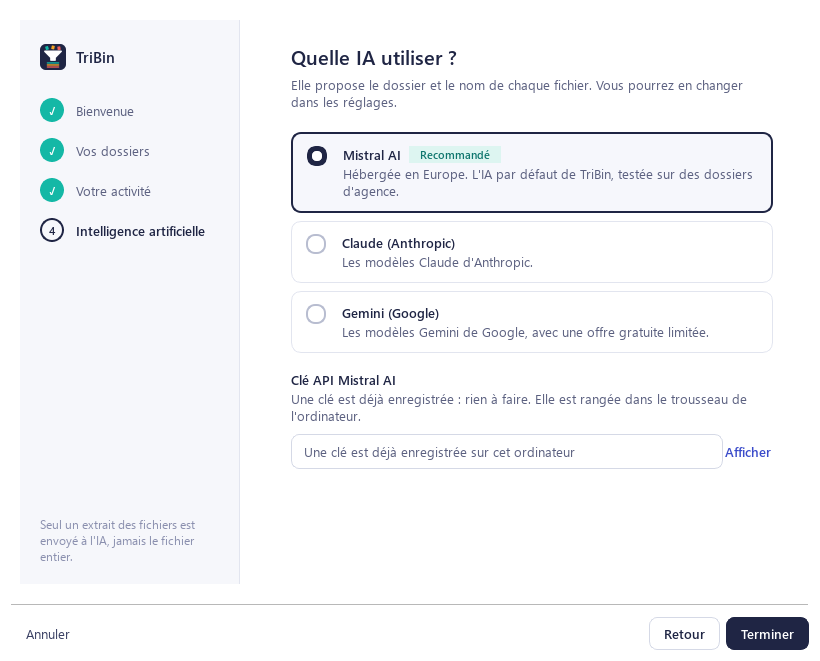 |

| Réglages › Dossiers | Réglages › Intelligence artificielle |
|---|---|
| 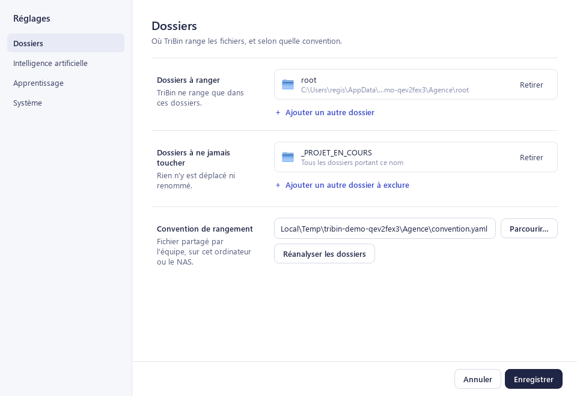 | 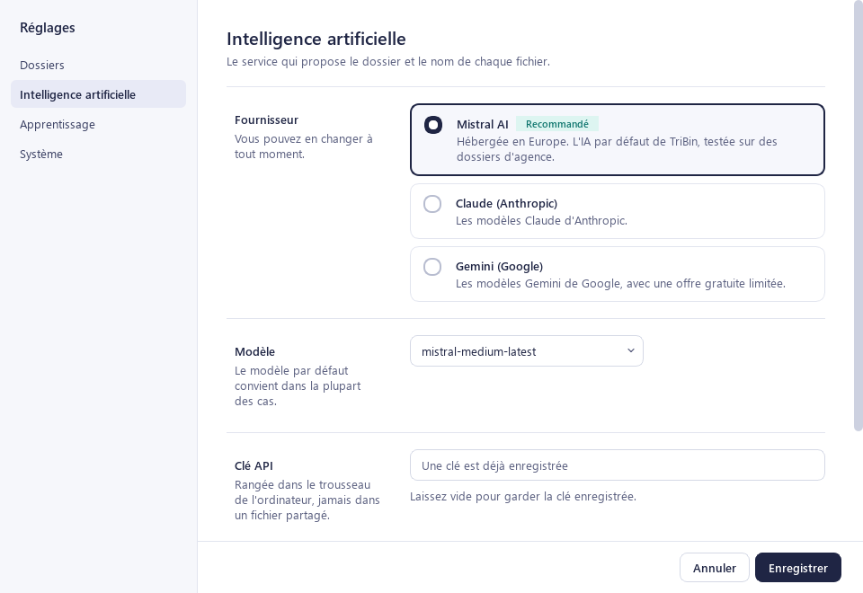 |

Captures réalisées avec des données de démonstration et une IA simulée ; pour les régénérer :
`uv run python scripts/make_screenshots.py`.

## En cas d'urgence : retrouver et annuler des opérations

Toutes les opérations sur les fichiers sont inscrites dans un **journal**, *avant* d'être exécutées.

| Système | Dossier des données (base, journal, profil, journal technique) |
|---------|------------------------------------------------------------------|
| macOS   | `~/Library/Application Support/TriBin/` |
| Windows | `%APPDATA%\TriBin\` |

Le journal se trouve dans le sous-dossier `journal/` (un fichier `journal-AAAA-MM.jsonl` par mois).
La variable `TRIBIN_DATA_DIR` permet de changer cet emplacement.

Le script de restauration fonctionne **même si l'application est cassée** (il n'utilise que Python) :

```bash
python src/tribin/safety/restore.py --journal "<dossier>/journal" --list
python src/tribin/safety/restore.py --journal "<dossier>/journal" --batch b_01...
python src/tribin/safety/restore.py --journal "<dossier>/journal" --batch b_01... --execute
```

Sans `--execute`, il se contente de montrer ce qu'il ferait. Il n'écrase jamais rien : si l'emplacement d'origine
est occupé, le fichier revient avec le suffixe `_restaure`.

## Règles de sécurité

- Rien n'est jamais supprimé : « supprimer » veut dire déplacer vers `_Archive/` à la racine.
- Rien n'est jamais écrasé : en cas de doublon, TriBin ajoute `_2`, `_3`… (même si seule la casse diffère).
- Aucun fichier n'est rangé hors des racines déclarées ni dans une zone exclue.
- Les lots (plusieurs fichiers ou création de dossiers) passent par une simulation montrée avant exécution.
- Entre deux disques (ex. ordinateur → NAS) : copie, vérification SHA-256, puis seulement retrait de l'original.
- En développement, `TRIBIN_DEV_SANDBOX=1` (valeur par défaut) interdit toute opération hors de `./sandbox/`.

## Installation (développement)

Prérequis : [uv](https://docs.astral.sh/uv/) (il installe Python 3.12 si besoin).

```bash
uv sync --extra ui --extra gemini --extra mistral
```

Copier `.env.example` en `.env`, choisir le fournisseur d'IA (`TRIBIN_PROVIDER=anthropic`, `gemini` ou `mistral`) et mettre
la clé correspondante (`ANTHROPIC_API_KEY`, `GEMINI_API_KEY` ou `MISTRAL_API_KEY`). Pour Gemini et Mistral, installer
aussi leur module : `uv sync --extra ui --extra gemini --extra mistral`. Dans l'application, le fournisseur se choisit dans Réglages › Intelligence
artificielle, et la clé est rangée dans le trousseau du système.

```bash
uv run python scripts/make_sandbox.py
```

```bash
uv run pytest
```

## Lancer l'application de bureau

```bash
uv run python -m tribin.ui.app
```

Au premier lancement : dossiers à ranger et à ne jamais toucher, convention (déduite de l'existant, ou un
fichier déjà prêt), quelques questions facultatives, choix de l'IA. Ensuite :

- glisser des fichiers sur le **widget flottant** (toujours au premier plan) ou sur la **fenêtre principale** ;
- Windows : glisser sur le raccourci du bureau, ou clic droit **Envoyer vers > TriBin** (à créer dans
  Réglages › Système) ;
- macOS (application empaquetée) : glisser sur l'icône du Dock.

Dans la fenêtre principale : `Entrée` ranger, `E` modifier le nom, `A` autre possibilité, `Échap` passer, `R` renvoyer à l'origine.
Chaque rangement s'annule depuis l'Historique.

## Ligne de commande

| Commande | Rôle |
|----------|------|
| `uv run python -m tribin propose <fichier> --root <racine> --convention <yaml> [--json]` | proposer, sans rien déplacer |
| `uv run python -m tribin propose-dir <dossier> --root <racine> --convention <yaml>` | proposer pour tout un dossier |
| `uv run python -m tribin eval sandbox/ [--model claude-sonnet-5-5] [-v]` | mesurer la qualité des propositions |
| `uv run python -m tribin map <racine> --convention <yaml> [--describe] [--suggest-convention out.yaml]` | cartographier l'existant |
| `uv run python -m tribin import-clients clients.csv --convention <yaml>` | ajouter des clients (copie de sauvegarde `.bak`) |
| `uv run python -m tribin init-structure --output convention.yaml` | structure proposée de zéro par l'IA |
| `uv run python -m tribin create-structure --root <racine> --convention <yaml> [--client X --year 2026 --project 2026-050_Nom]` | créer les dossiers (simulation d'abord) |
| `uv run python -m tribin file <fichier> --root <racine> --convention <yaml>` | proposer, simuler, ranger |
| `uv run python -m tribin history` / `undo --batch <id>` | historique et annulation |

Exemple sur la sandbox :

```bash
uv run python -m tribin propose sandbox/inbox/scan0042.pdf --root sandbox/root --convention sandbox/convention.yaml
```

## Évaluation de la qualité

`eval` génère les propositions **sans aucun déplacement**, affiche dossiers exacts / acceptables, clients,
catégories, noms exacts, confiance, temps et coût par fichier, et enregistre un CSV dans `eval_results/`.
Objectif avant usage réel : au moins 70 % de dossiers corrects sur la sandbox.

## Empaquetage (test du dépôt sur l'icône)

```bash
uv sync --extra ui --extra packaging
```

```bash
uv run python scripts/make_icons.py
```

```bash
uv run pyinstaller packaging/tribin.spec --noconfirm
```

Résultat : `dist/TriBin/TriBin.exe` (Windows) ou `dist/TriBin.app` (macOS, qui déclare `CFBundleDocumentTypes` pour
accepter les fichiers déposés sur le Dock). Sans signature : sous macOS, ouvrir la première fois par clic droit >
Ouvrir. La CI `package` (lancement manuel sur GitHub) construit les deux versions.

## Hypothèses prises pendant le développement

- Un fichier déposé peut venir de n'importe où (bureau, téléchargements) ; seule la **destination** doit être dans
  une racine. Il est d'abord déplacé dans `_TriBin/a_trier/` de la racine qui le contient, sinon de la racine du
  même disque, sinon de la première racine.
- Sans clé API, l'application fonctionne mais chaque proposition est « à traiter manuellement ».
- Hors des catégories « versionnées » de la convention, la version présente dans le nom d'origine est conservée.
- Un dossier déjà existant au moment de l'exécution n'est jamais retiré par une annulation.
